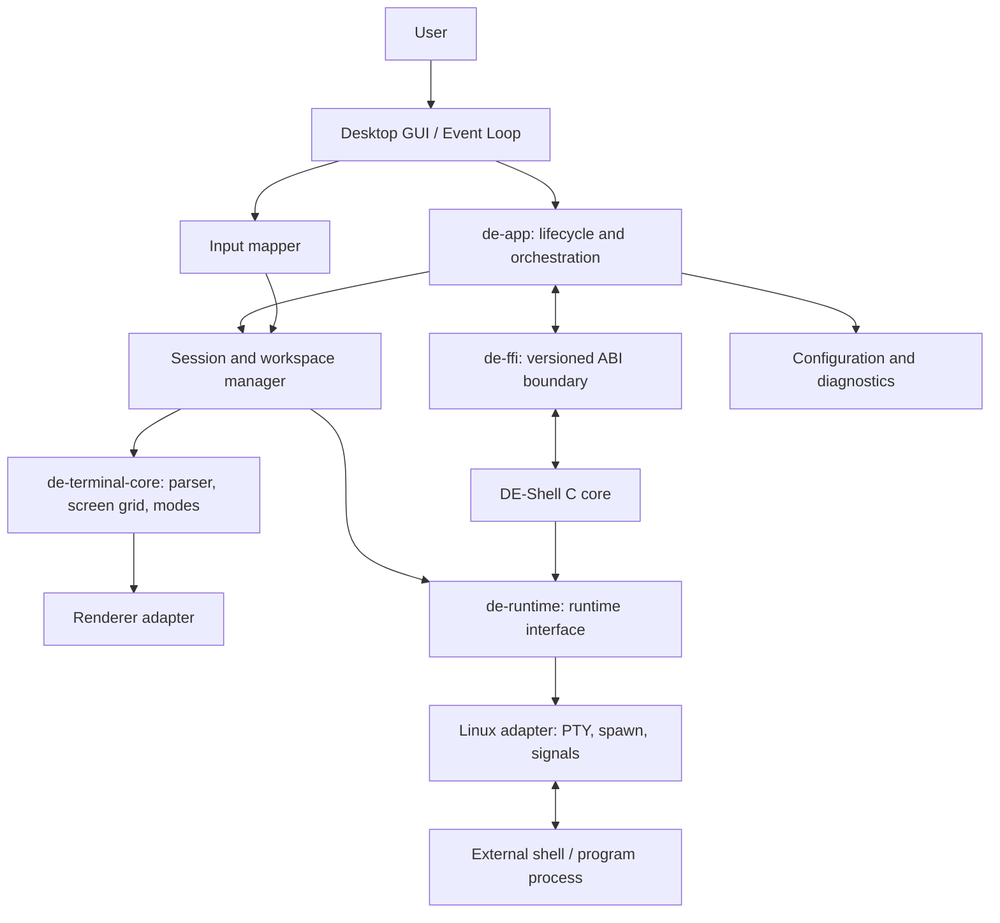

# System Architecture

**Status:** Architecture baseline for the Linux x86_64 implementation. Exact cross-component types and ABI signatures are specified separately in DE-002-02 (#30) and DE-008.

## 1. Architectural goals

Devil_Eye OS Terminal is a native terminal application, not a shell-only UI. It must:

- Keep the terminal emulator independent from any particular shell.
- Host external compatible shells and programs through PTY sessions.
- Provide DE-Shell as an independently implemented C shell core.
- Keep application lifecycle, orchestration, configuration, and rendering integration in Rust.
- Isolate operating-system behavior behind runtime/platform adapters.
- Give every terminal tab its own session, process ownership, I/O queues, and cleanup path.
- Make component ownership, failure propagation, resource limits, and security boundaries explicit.

Initial implementation target: Linux x86_64. Windows/ConPTY and macOS are future adapters, not current support claims.

## 2. Component and dependency view

The diagram describes logical ownership, not a claim that every component is already implemented. The Rust workspace currently contains only foundational contracts. DE-Shell and the runtime adapters are delivered by their own tasks.

### Dependency direction

- `de-app` composes subsystem interfaces; subsystem crates must not depend on `de-app`.
- `de-terminal-core` owns platform-independent terminal state and parsing.
- `de-runtime` owns runtime-facing process specifications and platform abstractions.
- `de-ffi` owns versioned Rust/C ABI declarations and translation types.
- C implementation details stay in the C subsystem; Rust does not duplicate the shell parser.
- Platform adapters depend inward on runtime contracts, never the reverse.

No cyclic crate dependencies are permitted.

## 3. Process and session model

### Application process

One application process owns the GUI event loop, global configuration, diagnostics, session registry, and renderer resources. Subsystems communicate through explicit interfaces and bounded queues; they do not independently create global application state.

### Terminal sessions

Each tab owns one terminal session. A session owns:

- One terminal state/screen model.
- One input/output transport.
- One runtime child-process handle when using a PTY-backed session.
- Session-local working directory, environment overrides, exit status, and lifecycle state.
- Bounded I/O buffers and a deterministic shutdown path.

A pane displaying the same session is a view, not a second owner of its process. If a user creates a new independent session, it receives a distinct PTY and child process.

### Session backends

1. **External shell/program backend:** the runtime creates a PTY and launches the selected executable as a child process. Bash, Zsh, Fish, and other compatible programs must work without DE-Shell-specific behavior.
2. **DE-Shell backend:** the C shell core is integrated through the versioned FFI boundary. The C core owns shell-language state and parsing; Rust owns application/session lifecycle and delegates OS process operations to the runtime interface. The exact request/event ABI, buffer rules, and ownership contract are finalized in #30 and #49 before implementation.

The two backends share terminal-facing input/output semantics but do not share parser state or shell-language implementation.

## 4. Data and control flows

### PTY-backed output

1. The child process writes bytes to its PTY slave.
2. The Linux PTY adapter reads from the master and forwards bytes to the owning session.
3. The terminal engine consumes the byte stream incrementally; reads may split escape sequences or UTF-8 code points across arbitrary boundaries.
4. The parser updates the screen grid, cursor, scrollback, and terminal modes.
5. The renderer is notified that a frame or region needs redraw.

### PTY-backed input

1. The GUI receives key, text, paste, mouse, or focus events.
2. The input mapper converts supported events into terminal input bytes according to the active terminal modes.
3. The session writes bytes to its PTY master with backpressure and error handling.
4. The child process receives the input through its PTY slave.

### DE-Shell command flow

1. The session forwards user input to the C shell core through the versioned FFI adapter.
2. The C core performs shell-language processing and produces a typed execution request or shell output event.
3. Rust validates the request and delegates permitted process operations to the runtime; it never concatenates untrusted input into a shell command string.
4. Output is returned to the session's terminal state through the same terminal-facing byte/event contract.
5. The detailed ABI, ownership, threading, and error mapping are specified by #30 and #49.

## 5. Lifecycle and ownership

### Startup

1. Parse command-line arguments and determine the configuration location.
2. Load configuration using validated defaults; reject malformed or unsupported values with actionable diagnostics.
3. Initialize diagnostics before starting services that may fail.
4. Initialize platform/runtime capabilities and renderer/GUI services.
5. Create the initial terminal model and session.
6. Start the selected shell/program only after the session has a valid terminal size and I/O transport.
7. Enter the GUI event loop.

Initialization is ordered. If step N fails, already-created resources are shut down in reverse ownership order. No partially initialized session is exposed as ready.

### Runtime

- The application/session manager is the sole owner of session lifecycle transitions.
- The PTY adapter owns file descriptors it creates and closes them exactly once.
- The runtime owns child-process handles and reaps exited children.
- The terminal engine owns its screen grid, parser state, and scrollback memory.
- The renderer borrows or receives immutable frame data; it does not mutate terminal state.
- FFI handles are opaque. Allocation and deallocation must occur on the side documented by the ABI; borrowed buffers are valid only for the duration specified by the contract.

### Shutdown

1. Stop accepting new input and new session creation.
2. Request graceful termination of active child processes.
3. Apply a bounded shutdown timeout, then force termination where required by policy.
4. Drain or discard remaining I/O according to the session shutdown contract.
5. Reap children and close PTY descriptors.
6. Destroy FFI/session resources in reverse creation order.
7. Persist permitted configuration/session metadata.
8. Shut down renderer and GUI services.

Shutdown must be idempotent. Cleanup errors are recorded without preventing cleanup of unrelated resources.

## 6. Concurrency and backpressure

- GUI/event-loop state is owned by its designated thread.
- PTY reads/writes and child-process wait operations must not block the GUI thread.
- Terminal state mutation is serialized per session. If parsing is moved to a worker, messages must preserve byte ordering.
- Cross-thread queues are bounded. When a consumer is slower than a producer, the system applies backpressure or a documented overflow policy; it must not grow memory without limit.
- A session failure must not corrupt or terminate unrelated sessions.
- FFI calls must obey a documented threading policy. No Rust panic or C exception/undefined behavior may cross the ABI boundary.

## 7. Error propagation and diagnostics

Errors are classified at subsystem boundaries (configuration, GUI, terminal model, FFI, runtime, PTY, child process, and persistence).

- Lower layers return structured errors; they do not terminate the application.
- The owning session decides whether an error is recoverable, session-fatal, or application-fatal.
- Child exit is a normal lifecycle event with an exit status, not automatically an application error.
- Diagnostics include operation, subsystem, and safe context; they exclude passwords, tokens, secret environment values, and raw sensitive input.
- Cleanup is attempted even after partial initialization or I/O failure.
- User-facing messages are separated from low-level diagnostic detail.

The typed Rust error model and C error translation are implemented in later application/FFI tasks.

## 8. Platform abstraction

The initial adapter targets Linux x86_64 and is responsible for:

- PTY allocation and configuration.
- Child process creation, environment, working directory, and file descriptor setup.
- Signal delivery, wait/reap, and exit status.
- Terminal resize propagation.
- Platform capability discovery.

These operations are exposed through `de-runtime` contracts. Linux-specific types must not leak into `de-terminal-core` or the public application configuration. Future Windows/ConPTY and macOS adapters must implement the same behavioral contract or document a capability difference.

## 9. Security boundaries and invariants

- Do not invoke a command interpreter by concatenating user input; pass executable and arguments as separate values.
- Validate executable paths, environment overrides, working directories, terminal dimensions, and all FFI inputs.
- Treat PTY output, escape sequences, paste data, and child-process output as untrusted input.
- Bound scrollback, parser buffers, queues, and per-session resource use.
- Keep session/process ownership explicit; never reuse another session's PTY or child handle.
- Never allow invalid pointers, lengths, enum discriminants, or ABI versions to cross the FFI boundary unchecked.
- Do not allow panics, exceptions, or allocator ownership ambiguity to cross Rust/C boundaries.
- Do not log secrets or full environment blocks.
- Plugins, if introduced later, require a separate capability and isolation design; they are not part of the initial trusted core.

## 10. Explicit non-goals for this architecture baseline

- This document does not claim a working GUI, renderer, PTY implementation, shell parser, or command execution engine.
- It does not select a GUI toolkit or renderer backend.
- It does not promise Windows/macOS support in the initial release.
- It does not define final C ABI signatures or Rust public API types; those belong in #30/#49.
- It does not authorize arbitrary plugin execution or elevated privileges.
- NASM is not required unless profiling proves a specific low-level routine needs it.

## 11. Verification strategy

Architecture decisions are verified incrementally through:

- Rust crate dependency checks and workspace tests.
- C library unit tests under strict compiler warnings.
- Contract tests for ownership, invalid inputs, ABI version mismatch, and error translation.
- Session lifecycle tests for startup failure, child exit, resize, EOF, signal, and cleanup.
- Terminal parser tests with fragmented input and malformed sequences.
- Multi-session tests proving isolation and independent teardown.
- Integration tests proving both DE-Shell and external shells can use the terminal-facing I/O contract.

The test harness and C test integration are tracked by DE-019. No architecture task is considered implementation evidence by itself.

## 12. Decisions to freeze in the API-contract task

DE-002-02 (#30) must turn the following architecture-level rules into concrete, reviewable contracts:

- Session lifecycle state machine and ownership transitions.
- Rust runtime process request and child-process handle semantics.
- Terminal input/output byte-stream and resize contract.
- C ABI version negotiation, opaque handles, buffer ownership, and error mapping.
- Threading/reentrancy policy for every FFI entry point.
- Shutdown, cancellation, and resource-limit behavior.
